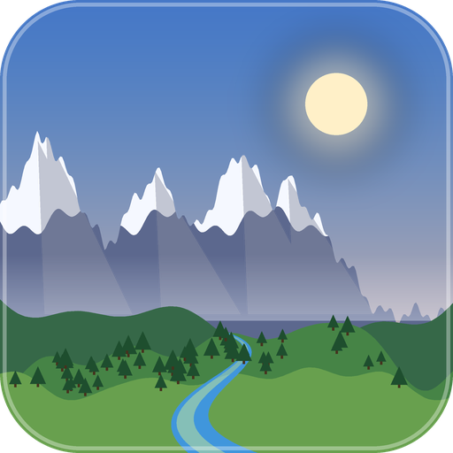
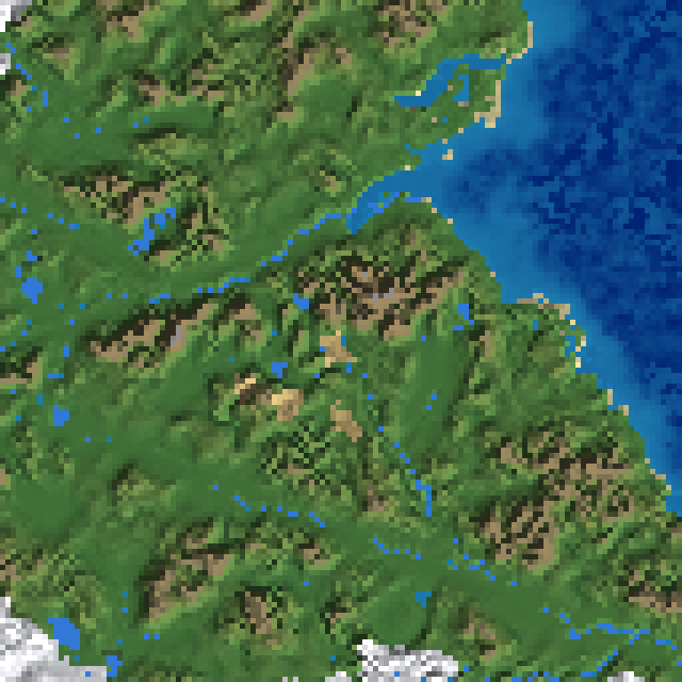
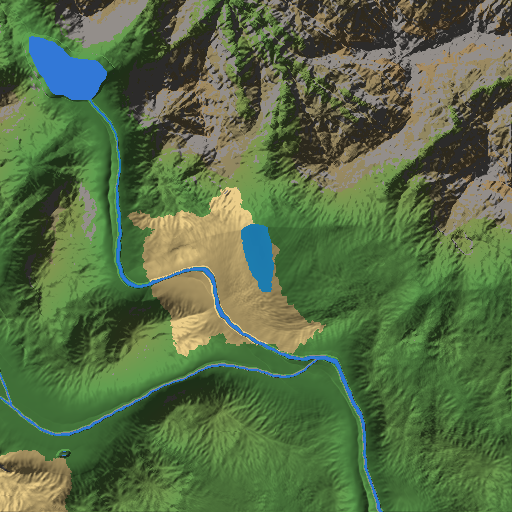
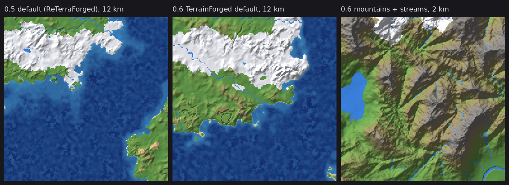

# TerrainForged

Realistic world generation for **Minecraft 1.21.11** on **Fabric** and **Forge**, built on a faithful port of
**ReTerraForged 1.20.1** ("RTF 0.0.6", the continuation of **TerraForged**): continents separated by real oceans,
connected mountain chains, blended terrain regions (plains, steppe, hills, dales, plateaus, badlands, torridonian,
mountains, volcanoes), river networks with branches, lakes and wetlands carved into valleys, droplet erosion,
TerraForged's rock/scree erosion decorator and natural snow, climate-driven vanilla biomes, and (since 0.6) mountain
streams and waterfalls running down into the rivers.

Made by Freak4U. ReTerraForged and TerraForged are MIT-licensed; see `THIRD_PARTY_NOTICES.md`.

Version **0.7.0** (beta).




*RTF preview, 6 km across (seed 12345).*


*Eroded terrain, 1 km across: a river leaving a lake, meandering through valleys between eroded mountains.*

## What changed in 0.7.0

* **Better mountain streams** (rivers unchanged):
  * **Full channels:** the water now sits level with the stream banks instead of a block or more down in a narrow
    dirt trench (in tests about 3 in 4 stream edges are flush with the lower bank and almost all are within 1 block).
  * **They follow the valleys:** streams are traced over a slightly smoothed height field, so they run down valley
    floors and join each other into bigger streams instead of zig-zagging across slopes.
  * **Every stream goes somewhere:** a stream that reaches a hollow fills it into a **small mountain lake** and leaves
    through the lowest point of its rim; streams that cannot reach a river, lake, the sea or a mountain lake are not
    generated (no more streams that just stop on a hillside). Lake shorelines are checked block by block, so a lake
    never hangs over a drop.
  * **Pools and rapids:** small dips along a stream fill into pools; steep stretches step down in 2-3 block drops.
* Default stream length 384 blocks, sources a bit denser (one possible source per 48×48 blocks).
* Streams in worlds created with 0.6 change shape in chunks generated after updating (start a new world for clean
  streams). Worlds from 0.5 or older still get no streams.

## What changed in 0.6.0



* **Mountain streams and waterfalls.** Streams start on hills and mountains and run downhill into rivers, lakes or
  the sea (or end in a small pool in a mountain hollow). They come in pools and drops: rapids on gentle slopes,
  3-7 block waterfalls on steep ones, and bigger falls over cliffs. Each stream is traced down the terrain at 2-block
  resolution; its water level only ever goes down and always sits below the ground, and when it is placed every
  water column is lowered until real terrain walls it in on all sides — so no floating water or sand walls (the 0.2
  problem). Placed water gets a fluid tick, so waterfalls start pouring when you get near. Settings (Rivers page):
  `rivers.streams.chance` (0.7, 0 = off), `min_altitude` (20 blocks above the sea), `max_length` (384). They also
  show on the preview map (light blue, when zoomed in to 2k blocks or closer).
* **New default: TerrainForged.** Based on ReTerraForged's Beautiful preset with taller mountains (mountain
  vertical scale 1.5, peaks up to ~280), more hills, plateaus and torridonian highlands, broader landforms, more
  land, 14 rivers, more lakes, and streams. ReTerraForged's own default is still there as the **ReTerraForged**
  preset. Config files written automatically by older versions are updated (old file kept as `*.json.old`); files you
  saved with "Save as Default" are left alone.
* **Random spawn** button next to Set Spawn: picks dry land a little above the sea, not in the mountains, close to a
  river, lake or stream. Press again for another spot.
* Existing worlds keep generating exactly as before (no streams in worlds created with 0.5 or earlier).

## What changed in 0.5.0

* **Choose your spawn point** on the Customize screen's map: press **Set Spawn** and click the map, or right-click
  the map at any time. A yellow pin shows the spot; **Clear Spawn** goes back to the automatic spawn. If the spot is
  in water, the nearest dry land (within 128 blocks) is used. The spawn is stored in the world and placed once, the
  first time the world starts (a later `/setworldspawn` is respected). Presets and "Save as Default" never include
  the spawn. Dedicated servers can add `"spawn.enabled": 1, "spawn.x": …, "spawn.z": …` to the config file before
  the world is created.
* Terrain generation is unchanged from 0.4.0.

## What changed in 0.4.0

* **Presets** on the Customize screen: ReTerraForged's Default, Beautiful, Huge Biomes, Lite and Vanilla-ish, plus
  Archipelago and Alpine. Save your own presets by name (`config/terrainforged/presets`), load and delete them.
* **Better world preview**: 256×256, Relief / Climate / Contour views, mouse-wheel zoom, drag to pan, and a read-out
  of coordinates, height, water/terrain type and climate under the cursor.
* **Snowy mountains** keep an even snow cover; only the steepest faces show bare stone.
* **Faster chunk generation**: each terrain tile's cells are generated in parallel (half the CPU cores, at least 2).
* **Mod icon** in the Fabric and Forge mod lists. New settings: continent type, biome-edge noise.
* Terrain shapes are unchanged from 0.3.0. Release and in-game checklist: `docs/RELEASE.md`.

## What changed in 0.3.0

* **Terrain re-ported from ReTerraForged's released 1.20.1 branch.** 0.2 was ported from RTF's unfinished 1.20.2
  rework branch (which, for example, still had a debug line and no river map). 0.3 uses the released pipeline:
  continents, region blending, mountain chains, volcanoes, RTF's climate, and RTF's **river / lake / wetland
  network carved into the heightmap**.
* **No more floating lakes or sand walls.** 0.2 ran its own drainage model on a coarse 64-block grid on top of the
  eroded terrain and placed water above sea level, which raised blocky banks where the two disagreed (the walls in
  your screenshot). Water now works like RTF: river beds, lakes and oceans are carved below sea level and vanilla's
  aquifers fill them.
* **TerraForged's surface decorators**: bare stone on steep and high ground, coarse dirt/gravel on moderate slopes,
  gravel scree, snow that slides off steep slopes, and snow layers that follow the exact terrain height.
* **Settings now mirror RTF's preset editor** (world, climate, terrain, terrain types, rivers & lakes, erosion,
  decoration; RTF's default values and slider ranges). The Customize preview uses RTF's own preview path.
* Worlds created with 0.2.x generate different terrain in new chunks — start a new world.

## What changed in 0.2.1

* **Fabric build fix**: Loom 1.18 requires a Java 25 JDK to run Gradle ("Dependency requires at least JVM runtime
  version 25. This build uses a Java 21 JVM."). The Fabric build now uses `fabric-loom` 1.17-SNAPSHOT, which runs
  on Java 21.
* `build-all.bat` no longer stops at the first failure, prints a summary and waits for a key so the window stays open.

## What changed in 0.2.0

* **New terrain**: v0.1's custom heightmap is replaced by a faithful port of ReTerraForged's generator:
  advanced continents, region-based terrain types with blending, mountain chains, volcanoes, and RTF's droplet
  erosion + smoothing on 128-block tiles. TerrainForged's continent-wide drainage (valley incision, lake basins,
  river networks with meanders) runs on top of it.
* **In-game settings screen**: Create World → More → World Type: TerrainForged → **Customize**. Every setting is a
  slider, with a live relief-map preview for the seed you typed (pan/zoom buttons). *Done* stores the settings in
  that world; *Save as Default* also writes them to the config file for future worlds.
* **Forge fix**: added `pack.mcmeta` (Forge logged "Missing metadata in pack mod:terrainforged"); Forge
  version range widened to 61.2+ (build configured for 61.2.3).
* Lake breaching so small pits drain instead of becoming hundreds of puddles.
* Config keys changed (see below). **Worlds created with 0.1.x will generate different terrain in new chunks** —
  start a new world for 0.2.

## Building

Requirements: JDK 21 (Gradle runs on it; Java 25 not needed), internet access for the first build (Gradle downloads Minecraft, Loom / ForgeGradle).

```bat
gradlew engineTests          :: engine test suite
gradlew -p fabric build      :: -> fabric\build\libs\terrainforged-0.7.0+fabric-1.21.11.jar
gradlew -p forge build       :: -> forge\build\libs\terrainforged-0.7.0+forge-1.21.11.jar
build-all.bat                :: all three in order
```

Dev runs: `gradlew -p fabric runClient` / `runServer`, `gradlew -p forge runClient` / `runServer`.
Preview maps without the game: `gradlew :common:renderMap -Pseed=12345 -Pbpp=32` (RTF preview; `-Pbpp=2 -Psize=512` renders the eroded world; PNG in `common/build/maps`).

## Installing

* **Fabric**: Fabric Loader ≥ 0.19.5 + Fabric API for 1.21.11; put the Fabric jar in `mods/`.
* **Forge**: Forge 1.21.11 (61.2.x); put the Forge jar in `mods/`.
* Install it on the server (or in single player). Installing it on clients too is recommended (needed for the
  Customize screen; Forge's mod-list handshake may require it).

## Using it

Create World → **More** → World Type → **TerrainForged** (or **TerrainForged (Tall 2048)**), optionally
**Customize**. Dedicated server: `level-type=terrainforged:terrainforged` in `server.properties` before the world
is created (settings then come from the config file).

## Configuration

New worlds read `config/terrainforged.json` (tall preset: `config/terrainforged-tall.json`), created with
defaults on first launch, or the values chosen on the Customize screen. Values are **copied into the world when it
is created**, so editing the file never changes existing worlds. Out-of-range values are clamped (logged);
malformed files fall back to defaults. Keys from older config files are ignored (logged) and the new keys use
their defaults; delete the old file to have it regenerated with the new keys.

The keys mirror ReTerraForged's preset editor (plus TerrainForged's streams and spawn). Since 0.6.0 the defaults are
TerrainForged's own (based on RTF's "Beautiful"); the table lists RTF's "Default" values, which the **ReTerraForged**
preset still uses. Changed in the TerrainForged default: continent type Multi, jitter 0.8, temperature scale 7 /
bias 0, biome size 185, region size 1350, vertical 1.0, horizontal 1.175, weights steppe 1.2, plains 2.0, hills 3.2,
dales 1.4, plateau 2.4, badlands 1.3, torridonian 3.6, mountains 3.8, volcano 6; vertical scale mountains 1.5, hills
1.15, torridonian 1.2; 14 rivers, lake chance 0.6, lake max start distance 0.028; erosion 175 droplets, volume 0.648,
velocity 0.657, smoothing radius 1.855, rate 0.916.

| Group | Settings (default) |
|---|---|
| World | `world.continent_scale` (3000), `continent_type` (Multi improved), `continent_jitter` (0.7), `continent_skipping` (0.25), `continent_size_variance` (0.25), `continent_noise_{octaves 5, gain 0.26, lacunarity 4.33}`, `world.control.{deep_ocean 0.1, shallow_ocean 0.25, beach 0.327, coast 0.448, inland 0.502}`, `world.sea_level` (63), `world.terrain_height` (256) |
| Climate | `climate.temperature.{scale 6, falloff 2, min 0, max 0.98, bias 0.05}`, `climate.moisture.{scale 6, falloff 1, min 0, max 1, bias 0}`, `climate.biome_size` (225), `macro_noise_size` (8), `biome_warp_scale` (150), `biome_warp_strength` (80), `climate.biome_edge.{type Simplex, scale 24, octaves 2, gain 0.5, lacunarity 2.65, strength 14}` |
| Terrain | `terrain.region_size` (1200), `vertical_scale` (0.98), `horizontal_scale` (1.0), `fancy_mountains` (1) |
| Terrain types | `terrain.<type>.{weight, base_scale, vertical_scale, horizontal_scale}` for steppe (1), plains (2), hills (2), dales (1.5), plateau (1.5), badlands (1), torridonian (2), mountains (2.5), volcano (5) — weight 0 disables a type |
| Rivers & lakes | `rivers.river_count` (8), `rivers.main.{bed_depth 5, min_bank_height 2, max_bank_height 6, bank_width 20, bed_width 8, fade 0.75}`, `rivers.branch.{4, 1, 4, 14, 5, 0.975}`, `rivers.lake.{chance 0.3, min_start_distance 0, max_start_distance 0.03, depth 10, size_min 75, size_max 150, min_bank_height 2, max_bank_height 10}`, `rivers.wetland.{chance 0.6, size_min 175, size_max 225}` |
| Erosion | `erosion.droplets_per_chunk` (135), `droplet_lifetime` (12), `droplet_volume` (0.7), `droplet_velocity` (0.7), `erosion_rate` (0.5), `deposit_rate` (0.5), `smoothing_iterations` (1), `smoothing_radius` (1.8), `smoothing_rate` (0.9) |
| Decoration | `decoration.erosion_decorator` (on), `natural_snow` (on), `smooth_snow_layers` (on) |
| Streams | `rivers.streams.chance` (0.7), `rivers.streams.min_altitude` (20), `rivers.streams.max_length` (384; range 64-2048) |
| Spawn (optional, per world) | `spawn.enabled` (0), `spawn.x`, `spawn.z` — not written to the file by default; add them for a fixed spawn on a dedicated server |

The tall preset defaults to `world.terrain_height` 900, `terrain.vertical_scale` 0.9, `terrain.horizontal_scale`
1.6, `world.continent_scale` 4500 and `terrain.region_size` 1800.

Structures: use the vanilla "Generate Structures" world option.

## Compatibility

Vanilla caves, aquifers, ores, structures, features, mob spawning and `/locate` keep working — TerrainForged
replaces the terrain and climate inputs of the vanilla noise router. Biome mods that extend the vanilla overworld
biome parameter list should work (not tested with specific mods). The only mixin is a client-side hook on Fabric
that enables the Customize button (Forge uses its `RegisterPresetEditorsEvent`). The chosen spawn is placed from the
loaders' "server started" events (Fabric `ServerLifecycleEvents.SERVER_STARTED`, Forge `ServerStartedEvent`).

## Status

See `docs/ENGINEERING.md` for the engineering report, test results and known limitations.
